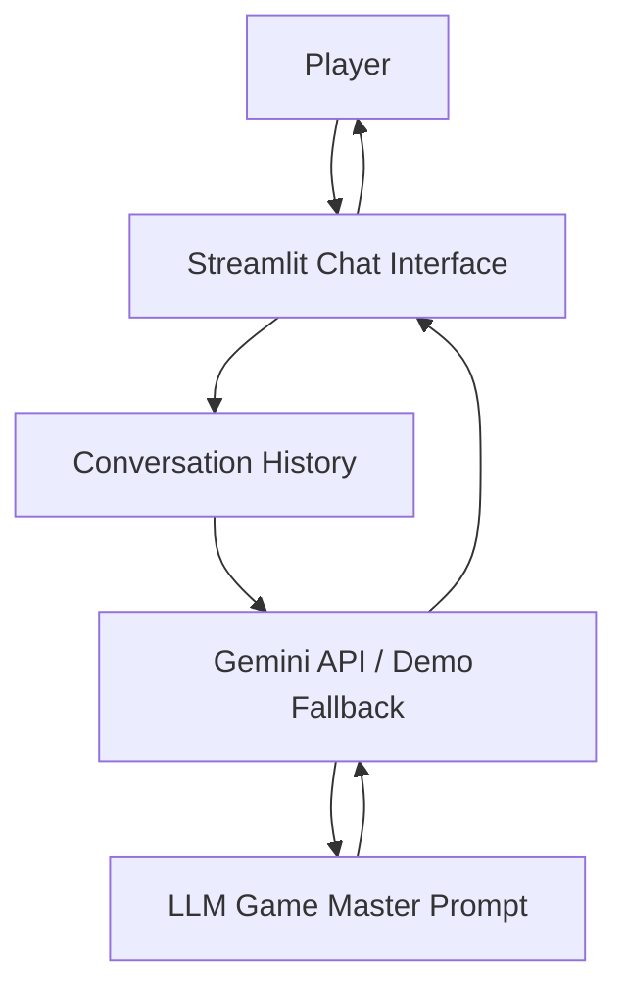
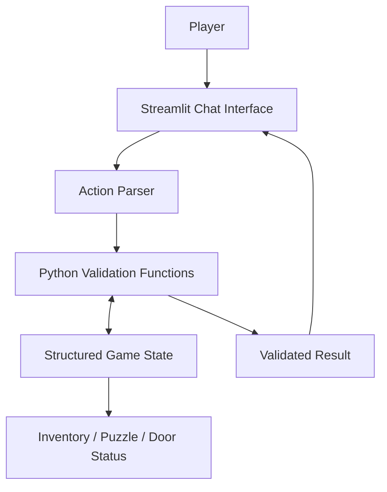

# Architecture diagrams

## Version 1 — Interactive LLM Game Master

The player sends natural-language messages through Streamlit. The application includes conversation history and game instructions in the prompt. The LLM interprets the action and generates the next narrative response. Since the LLM is responsible for remembering and applying most rules, it may occasionally make inconsistent decisions.

## Version 2 — Validated Game Engine

Python parses each action, checks prerequisites and updates structured state. The interface displays only the validated result. Important rules and solutions are stored in Python rather than being controlled by generated text. This prevents the model or player from bypassing puzzle requirements.
